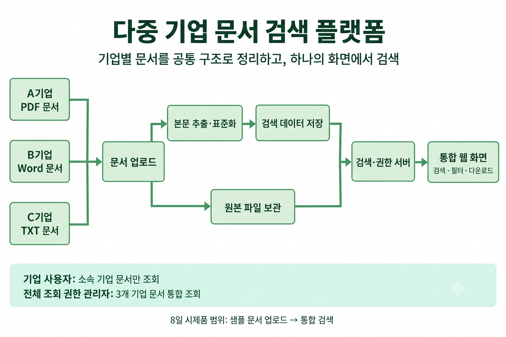

<br>


## 우문현답, 우리들의 거친 문제도 현대의 답으로

검색할 때마다 완벽한 질문을 던질 수는 없습니다.
현답은 거친 질문에도 **회사 문서에 근거한 답**을 찾아 주는 AI 문서 검색 플랫폼을 만든 팀입니다.

<br>


<table>
  <tr>
    <td align="center" colspan="3">
      <br>
      <h2>이성민</h2>
      <h3>팀장</h3>
      <b>맡은 일</b> 일정·통합 관리, 공통 설정·스키마, 로그인·계정, 테스트·QA<br>
      <b>담당 폴더</b> <code>common/</code> · <code>auth/</code> · <code>tests/</code><br>
      <a href="https://github.com/paul8004-lee">@paul8004-lee</a>
    </td>
  </tr>
  <tr>
    <td align="center" width="33%">
      <br>
      <h2>전재경</h2>
      <b>맡은 일</b> DB 설계·저장, 회사 권한 확인<br>
      <b>담당 폴더</b> <code>db/</code><br>
      <a href="https://github.com/wjsworud1025">@wjsworud1025</a>
    </td>
    <td align="center" width="33%">
      <br>
      <h2>박영준</h2>
      <b>맡은 일</b> 임베딩·벡터 저장<br>
      <b>담당 폴더</b> <code>embedding/</code><br>
      <a href="https://github.com/joon0724">@joon0724</a>
    </td>
    <td align="center" width="33%">
      <br>
      <h2>박경환</h2>
      <b>맡은 일</b> 화면(UI)·앱 실행<br>
      <b>담당 폴더</b> <code>ui/</code> · <code>app.py</code><br>
      <a href="https://github.com/qkrrud141">@qkrrud141</a>
    </td>
  </tr>
  <tr>
    <td align="center" width="33%">
      <br>
      <h2>이준영</h2>
      <b>맡은 일</b> 검색·필터<br>
      <b>담당 폴더</b> <code>search/</code><br>
      <a href="https://github.com/wljycjdi2001-ljy">@wljycjdi2001-ljy</a>
    </td>
    <td align="center" width="33%">
      <br>
      <h2>소용우</h2>
      <b>맡은 일</b> AI 답변·요약(챗봇)<br>
      <b>담당 폴더</b> <code>chatbot/</code><br>
      <a href="https://github.com/nasaro-pro">@nasaro-pro</a>
    </td>
    <td align="center" width="33%">
      <br>
      <h2>김혜리</h2>
      <b>맡은 일</b> 문서 수집·전처리<br>
      <b>담당 폴더</b> <code>ingest/</code><br>
      <a href="https://github.com/doxoba">@doxoba</a>
    </td>
  </tr>
</table>

<br>


## 업무·기술 매뉴얼 기반 AI 지식 탐색 및 요약 서비스

세부 주제는 **다중 기업 문서 검색 플랫폼**입니다.
기업별로 흩어진 매뉴얼·교육 자료·공개 자료를 **공통 구조로 정리**하고, **하나의 화면에서 검색**합니다.

<div align="center">

</div>

### 챗봇이 아니라 검색 플랫폼입니다

실무자에게 필요한 것은 긴 대화형 답변보다 **원하는 내용이 어느 문서의 어느 위치에 있는지**를 바로 확인하는 일입니다.
현답은 검색 결과를 중심에 두고, AI 답변과 요약은 모두 **원본 문서의 근거와 연결된 경우에만** 보여 줍니다.

| 기능 | 내용 |
|---|---|
| **문서 검색** | 검색어와 문서 유형으로 찾습니다. 전체 관리자는 검색할 회사를 고를 수 있습니다. 결과 목록에서 문서를 고르면 오른쪽에 상세 정보와 근거 문장이 나옵니다. |
| **짧은 AI 답변** | 검색어를 질문으로도 사용해, 이번 검색 결과 문서 안에서 찾은 답을 검색창 바로 아래에 한 줄로 보여 줍니다. |
| **문서 요약** | 선택한 문서를 요약하고, 생성되는 내용을 줄 단위로 바로 보여 줍니다. 근거 표시가 없는 문장은 화면에 내보내지 않으며, 요약에 포함한 범위와 제외한 범위를 함께 표시합니다. |
| **출처 확인·원본 다운로드** | 답변과 요약의 출처 번호에서 회사·파일·위치(쪽, 섹션, 슬라이드)를 확인하고 원본 파일을 내려받습니다. |
| **문서 업로드** | 관리자가 PDF·DOCX·PPTX 파일을 여러 개 올립니다. 형식·암호·손상·구형 형식·중복을 검사한 뒤, 본문을 나누고 임베딩해 모든 조각이 저장된 경우에만 검색에 공개합니다. |
| **회사별 권한** | 직원과 회사 관리자는 소속 회사 문서만, 전체 관리자는 허용된 모든 회사 문서를 봅니다. 화면이 보낸 역할·회사 값은 믿지 않고, 매 요청마다 서버가 DB 기준으로 다시 확인합니다. |

<br>


## 구현 범위

### 완료한 기능

| 영역 | 내용 |
|---|---|
| 로그인 | 아이디·비밀번호 로그인, 서버 세션 발급·재검증·로그아웃, 역할 3종(직원·회사 관리자·전체 관리자) |
| 검색 | 의미 기반 검색(벡터 유사도), 문서 유형·회사 필터, 회사 범위 밖 결과 차단 |
| AI 답변 | 검색 결과 문서 범위의 근거 기반 답변, 근거 없는 문장 거부, 반환 직전 권한 재확인 |
| 요약 | 문서 크기에 따라 최대 3구간으로 나눠 차례로 요약, 줄 단위 실시간 표시, 포함·제외 범위 표시 |
| 업로드 | 여러 파일 순차 처리, 파일별 결과 표시, 원본 보관, 문서 버전 이력 |
| 수집 | PDF(쪽)·DOCX(섹션)·PPTX(슬라이드) 본문 추출, 표 처리, 글자 정규화, 섹션 경계를 넘지 않는 청크 분할 |

### 제외한 기능 (향후 과제)

- 회원가입·비밀번호 변경 등 계정 관리 화면, 관리자용 문서 삭제·재색인 화면
- 원문 PDF 뷰어, 특정 쪽 바로 열기
- HWP·XLSX 등 추가 파일 형식, 이미지로만 된 스캔 문서의 글자 인식
- 대화 이력 저장

<br>

## 시스템 구조

### 폴더 구성

| 폴더 | 역할 | 담당 |
|---|---|---|
| `hyundap/app.py`, `hyundap/ui/` | Gradio 화면, 화면과 백엔드 함수 연결 | 박경환 |
| `hyundap/auth/` | 로그인, 세션, 계정 생성, 회사 권한 확인 | 이성민 |
| `hyundap/db/` | MySQL 저장 구조, 업로드 처리 흐름, 문서 버전 | 전재경 |
| `hyundap/ingest/` | 파일 검증, 본문 추출, 청크 분할 | 김혜리 |
| `hyundap/embedding/` | OpenAI 임베딩, Chroma 벡터 저장소 | 박영준 |
| `hyundap/search/` | 검색, 필터, 권한 범위 적용 | 이준영 |
| `hyundap/chatbot/` | 근거 기반 답변, 문서 요약, 인용 검사 | 소용우 |
| `hyundap/common/` | 공통 설정, 공통 자료형(문서·청크·문서 유형) | 이성민 |
| `hyundap/tests/` | 단위·통합 테스트, QA·사용성 테스트 | 이성민(DB 테스트는 전재경) |

폴더별 상세 설계는 각 폴더의 `README.md`와 `docs/spec.md`에 있으며, 전체 기능 명세는 [docs/spec.md](docs/spec.md)에 있습니다.

### 처리 흐름

```text
[업로드] 관리자 → ui → db.upload_service
            → ingest(검증·본문 추출·청크 분할) → embedding(임베딩·벡터 저장)
            → db(모든 청크 저장 확인 후 버전 공개)

[검색]  사용자 → ui → auth(세션·권한 확인) → search(벡터 검색·회사 필터) → 결과 목록
[답변]  검색 결과 문서 → chatbot.ask(근거 기반 답변·인용 검사) → 검색창 아래 한 줄 답변
[요약]  선택 문서 → chatbot.summary(구간별 요약·줄 단위 인용 검사) → 상세 영역에 실시간 표시
```

<br>

## 실행 방법

모든 명령은 **저장소 맨 위 폴더**에서 실행합니다(`cd hyundap` 하지 않음). Python 3.11 이상이 필요합니다.

```bash
python -X utf8 -m pip install -r requirements.txt   # 패키지 설치
python -m hyundap.app                               # 앱 실행 (http://127.0.0.1:7860)
python -m hyundap.app --mode demo                   # 예시 데이터로 화면 확인 (DB·OpenAI 호출 없음)
python -m hyundap.app --check-backend               # 함수·패키지·설정 준비 상태만 점검
python -m unittest discover -s hyundap/tests -t .   # 전체 테스트
```

`-X utf8`는 파이썬을 UTF-8 모드로 켜는 옵션입니다. requirements.txt에 한글 주석이 있어서, Windows 기본 인코딩(cp949)으로 요구 사항 파일을 읽는 구버전 pip(예: Python 3.11.9에 포함된 pip 24.0)에서는 설치가 `UnicodeDecodeError`로 실패합니다. 이 옵션을 붙이면 운영체제나 pip 버전에 상관없이 같은 명령으로 설치됩니다.

패키지 설치 성공은 백엔드 서비스 준비 완료와 다릅니다. 설치 후 `python -m hyundap.app --check-backend`로 준비 상태를 점검하고, 실제 서비스 동작에는 아래 `.env` 설정과 인증 연동이 추가로 필요합니다.

포트를 바꾸려면 `--port 7861`처럼 지정합니다. 예시 모드의 체험 계정과 화면별 동작은 [UI 안내](hyundap/ui/README.md)를 참고합니다.

### 환경 설정 (`.env`)

저장소 맨 위 폴더에 `.env` 파일을 만들고 아래 항목을 채웁니다. `.env`는 커밋하지 않습니다.

| 항목 | 필수 | 내용 | 기본값 |
|---|:---:|---|---|
| `DATABASE_URL` | 필수 | 팀 공용 MySQL 접속 주소. 발급·형식은 [MYSQL_ACCESS.md](MYSQL_ACCESS.md) 참고 | — |
| `OPENAI_API_KEY` | 필수 | 임베딩·답변·요약에 사용하는 OpenAI API 키 | — |
| `OPENAI_CHAT_MODEL` | 선택 | 답변·요약 모델 | `gpt-5` |
| `OPENAI_EMBEDDING_MODEL` | 선택 | 임베딩 모델 | `text-embedding-3-small` |
| `CHROMA_DB_PATH` | 선택 | 벡터 저장소 폴더 | `data/chroma_db` |
| `UPLOAD_DIR` | 선택 | 업로드 원본 보관 폴더 | `data/uploads` |
| `CHUNK_SIZE`, `CHUNK_OVERLAP` | 선택 | 청크 길이와 겹침(글자 수) | `1000`, `150` |
| `SEARCH_MIN_SCORE`, `SEARCH_TOP_K_MAX` | 선택 | 검색 최소 유사도와 최대 조회 수 | `0.3`, `80` |
| `SESSION_TTL_MINUTES` | 선택 | 로그인 세션 유지 시간(분) | `480` |

### 계정 만들기

계정은 DB 접속 권한이 있는 운영자가 명령으로 만듭니다. 비밀번호는 실행 중에 입력하며 명령줄에 적지 않습니다.

```bash
python -m hyundap.auth.create_account --email admin@example.com --role platform_admin
```

역할은 `platform_admin`(전체 관리자), `company_admin`(회사 관리자), `employee`(직원) 중 하나입니다. 회사 관리자와 직원은 `--company-id`로 소속 회사 ID를 함께 지정합니다. 자세한 내용은 [auth 명세](hyundap/auth/docs/spec.md)를 참고합니다.

<br>

## 테스트와 품질

| 구분 | 내용 | 결과·문서 |
|---|---|---|
| 단위·통합 테스트 | 폴더별 테스트 31개 파일. MySQL이 필요한 DB 테스트는 테스트 DB 주소가 있을 때만 실행 | `python -m unittest discover -s hyundap/tests -t .` |
| 기능 점검 (WBS 4.1) | 형식별 업로드, 필터 검색, 검색 정확도, 권한, 예외 상황 43건 | 41/43 통과 · [결과서](hyundap/tests/qa/TEST_REPORT.md) · [시나리오](hyundap/tests/qa/TEST_SCENARIOS.md) |
| 사용성 테스트 | 실제 계정으로 로그인부터 업로드·검색·요약까지 화면 점검 | [결과](hyundap/tests/usability/RESULTS.md) · [계획](hyundap/tests/usability/TEST_PLAN.md) |

기능 점검에서 남은 실패 2건은 결과서 5장에 정리했습니다(검색 정확도 1문항, 구형 Office 파일 안내 1건).

<br>

## 개발 규칙

- **폴더 담당**: 각자 담당 폴더만 수정합니다. 다른 폴더 변경이 필요하면 이슈나 PR 리뷰로 담당자에게 요청합니다.
- **브랜치와 PR**: `develop`에서 작업 브랜치를 만들고, PR로 `develop`에 병합합니다. 병합 전 리뷰 승인 1건이 필요합니다.
- **주석과 문서**: 코드 주석과 docstring은 한글로 씁니다.
- **import**

| 상황 | 쓰는 법 |
|---|---|
| 다른 폴더 기능 | `from hyundap.common.config import get_settings` |
| 같은 폴더 안 파일 | `from .models import IngestError` |
| 쓰지 않는 형태 | `from common...`처럼 `hyundap.`이 없는 형태, `sys.path` 조작 |

<br>


| 구분 | 사용 기술 |
|---|---|
| 화면 | Gradio |
| AI | OpenAI(`gpt-5`, `text-embedding-3-small`), LangChain |
| 저장소 | MySQL(Railway), Chroma(벡터 저장소) |
| 문서 처리 | pypdf, python-docx, python-pptx |
| 협업 | GitHub(이슈·PR·리뷰) |


전공자는 없지만 AI 에이전트와 함께 개발했습니다.

<br>


### [demo-repository](https://github.com/hyundaisightcampus3/demo-repository)
