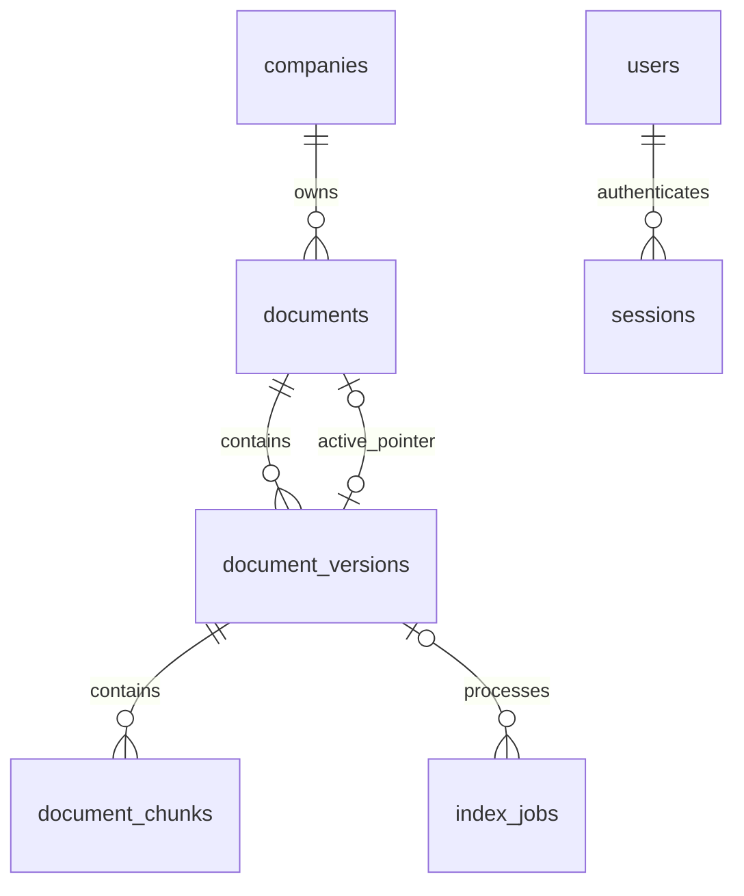

# 스키마 v4 정의 — #119

2026-10-26 채택 계약: [DB_contract.md](DB_contract.md). 기존 8개 업무 테이블과 schema_migrations를 보존하고 document_versions/document_chunks만 추가한다. 실제 공유 DB는 접속 설정이 없어 아직 조회하지 못했다. 아래 구조와 격리 테스트의 v3 기준 구조를 실제 DB 실측 결과로 오해하지 않는다.

## 관계

활성 포인터는 `documents(active_version_id,id,company_id)` → `document_versions(id,document_id,company_id)`의 복합 FK다. 버전은 `document_versions(document_id,company_id)` → `documents(id,company_id)`를 참조한다. documents의 활성 포인터는 nullable이므로 문서 → 후보 버전 → 포인터 순서로 생성할 수 있다. 물리 삭제 대신 soft-delete를 사용하며 순환 FK의 CASCADE 삭제는 사용하지 않는다.

사용자·세션 관계는 기존 구조를 보존한다. 신규 준비 도구는 기존 users/sessions FK를 재설계하지 않는다. 실제 DB 확인 시 기존 인증 관계도 검토하고 불일치는 자동 수정하지 않는다.

## 기존 테이블 변경

| 테이블 | 추가 컬럼 | 기본값·기존 데이터 처리 |
|---|---|---|
| documents | doc_type VARCHAR(50), publication_status VARCHAR(16), deleted_at DATETIME(6), active_version_id VARCHAR(36) | other/draft/NULL/NULL. 기존 문서는 자동 공개하지 않음 |
| users | password_hash VARCHAR(255), auth_version INT, login_identifier VARCHAR(254) | NULL/1/LOWER(TRIM(email)) STORED. 기존 이메일은 변경하지 않음 |
| sessions | token_hash CHAR(64) ascii_bin, auth_version INT, expires_at/revoked_at DATETIME(6) | NULL/0/NULL/NULL. 기존 세션은 새 auth_version=1과 불일치하여 새 인증에서 거부 |
| index_jobs | version_id VARCHAR(36), stage VARCHAR(32), report JSON, error_code VARCHAR(64), error_message VARCHAR(1000), attempts INT | NULL/received/NULL/NULL/NULL/0. 기존 작업 기록 보존 |

company_id와 id의 기존 물리 이름·타입을 변경하지 않는다. companies.name/is_active, users.company_id/email/role/is_active, sessions.user_id 및 기존 job 상태 컬럼은 보존한다. 기존 index_jobs의 상태 enum·필수 필드는 실제 DB 확인 후 #121에서 매핑하며 임의로 덮어쓰지 않는다. 새 stage는 처리 단계이며 기존 status와 별개다. oauth_states/audit_logs/login_attempts는 변경하지 않는다.

기존에 같은 이름의 대상 컬럼이 있으면 타입·키 collation·생성식 호환 여부를 확인한다. 불일치 시 SQL을 생성하지 않는다. 기존 TIMESTAMP와 새 DATETIME(6) 등 타입 차이를 자동 변환하지 않는다. 인덱스는 동등한 UNIQUE/FK가 있으면 재사용한다. 사용자·세션 새 컬럼의 실제 사용은 #120에서 구현한다.

## document_versions

| 컬럼 | 타입·필수 | 의미 |
|---|---|---|
| id | VARCHAR(36) PK | UUID 문자열; documents.id의 charset/collation 사용 |
| document_id, company_id | VARCHAR(36) NOT NULL | 문서·회사 복합 FK; 회사 키는 companies.id의 charset/collation 사용 |
| version_no | INT NOT NULL | 1 이상, 문서 안에서 유일 |
| file_name, storage_path | VARCHAR(255), VARCHAR(1024) NOT NULL | 화면용 파일명과 내부 원본 경로; 경로는 UI에 직접 노출하지 않음 |
| sha256, file_size | CHAR(64) ascii_bin, BIGINT NOT NULL | 소문자 hex; 1~104857600바이트 |
| version_status | VARCHAR(16) NOT NULL | processing(default)/ready/failed |
| data_category | VARCHAR(16) NOT NULL | operational(default)/evaluation |
| expected_chunk_count | INT NOT NULL DEFAULT 0 | 0~100000; ready면 양수 |
| created_at | DATETIME(6) NOT NULL | UTC, CURRENT_TIMESTAMP(6); 연결 time_zone을 UTC로 설정 |

UNIQUE(document_id,version_no), UNIQUE(id,document_id,company_id), UNIQUE(company_id,sha256). 같은 파일의 삭제 후 재업로드는 P0에서 거부한다. 실패 재시도는 동일 버전을 사용한다. 같은 해시의 다른 회사는 허용한다.

## document_chunks

| 컬럼 | 타입·필수 | 의미 |
|---|---|---|
| id | VARCHAR(64) ascii_bin PK | version_id + ':' + 5자리 chunk_index |
| version_id | VARCHAR(36) NOT NULL FK | document_versions.id와 같은 charset/collation |
| chunk_index | INT NOT NULL | 0~99999, 버전 안에서 유일 |
| content_hash | CHAR(64) ascii_bin NOT NULL | 최종 청크 text의 UTF-8 SHA-256 |

벡터·청크 본문은 Chroma에 보관하고 DB에 중복 저장하지 않는다. PK와 UNIQUE(version_id,chunk_index)가 조회 인덱스도 제공한다. manifest 순번의 연속성·개수는 검증 SQL과 #122 서비스에서 확인한다. DB CHECK로 교차 테이블 완전성을 보장한다고 주장하지 않는다.

## 제약과 서비스 책임

| 항목 | DB 보호 | 서비스 검증 |
|---|---|---|
| 회사·문서·활성 버전 일치 | 복합 FK | 현재 사용자·회사 활성·권한 확인 |
| 버전·해시·청크 중복 | UNIQUE/PK | 중복 오류 변환·같은 후보 재시도 |
| 공개·자료·버전 상태 | CHECK 허용값; published면 포인터 필수 | ready·operational·완전한 청크 집합인 후보만 게시 |
| 청크 ID·순번·해시 | CHECK/UNIQUE | 양수 예상 수, 연속 순번, DB/Chroma 집합 일치·출처 소속 검증 |
| 세션 | 정규화 이메일·토큰 해시 UNIQUE | 현재 auth_version·만료·폐기·계정 활성 확인 |

DB 자체는 ready의 외부 Chroma 적재 여부를 알 수 없다. `004_verify.sql`은 DB 내부 정합성 점검이며 외부 적재 완전성 검증을 대체하지 않는다.

## 명세 추적과 보완 구분

| 명세 | 구현 구조 | 연계 담당 |
|---|---|---|
| F39 / 제약_운영 A9:G9 | 원본·문서·버전 정보 | 김혜리·박경환, 경로 설정 이성민 |
| CLS-050 / 데이터정의 A6:I16 | 문서·활성 버전 11필드 | 이준영 |
| F63 / FUN-206 | 회사+해시 UNIQUE 및 조회 | 김혜리 |
| F112 / FUN-318 | 청크 manifest | 김혜리·박영준 |
| 기존 인증 저장 구조 | 사용자·세션 컬럼은 데이터 구조로 보존. 로그인·비밀번호·세션 발급/폐기 구현 제외 | 외부 인증 담당과 실제 계약 확인 필요 |
| F41 / 처리 보고서 | 작업 기록 확장 | 김혜리·박영준·박경환 |

새 물리 컬럼·유일성·FK·CHECK·마이그레이션 방식은 명세 기능을 구현하는 보완 설계다. 관리 UI, 독립적인 광범위 감사 체계, 전체 저장소 통합 복구는 포함하지 않는다.
