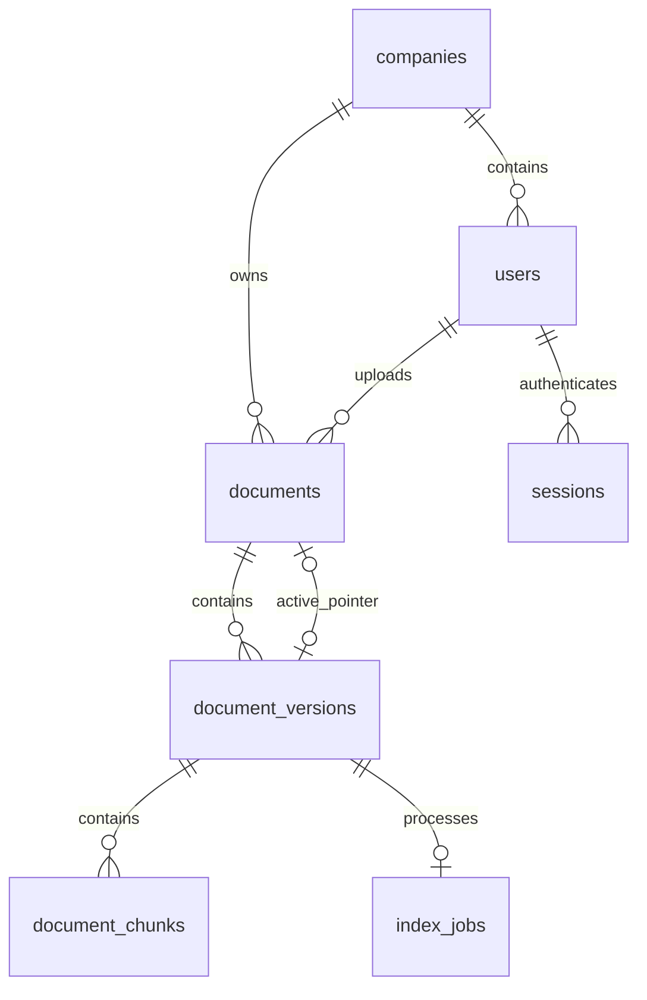

# 최종 v4 물리 스키마 — #168

2026-10-27. v3 이행이나 기존 테이블 확장을 거치지 않는 빈 DB 직접 생성 계약이다. [schema_v4.sql](schema_v4.sql)이 최종 DDL이고 [schema_v4_contract.json](schema_v4_contract.json)이 전체 구조 검증 기준이다. 초기화는 [V4_INITIALIZATION.md](V4_INITIALIZATION.md)를 따른다.

## 관계와 보호

활성 포인터 `(active_version_id,id,company_id)`와 작업 `(version_id,document_id,company_id)`는 버전의 `(id,document_id,company_id)`에 복합 FK로 연결한다. 회사가 다른 버전·작업을 붙일 수 없다. 버전은 `(document_id,company_id)`로 문서에 연결한다. 순환 활성 FK는 문서·버전 생성 뒤 추가한다.

문서/버전 번호와 회사/해시는 각각 UNIQUE다. 청크는 버전/순번이 UNIQUE이며 ID는 `version_id:00000` 형식이다. ready는 양수 예상 개수가 필요하고 실제 목록 일치는 `schema_v4_verify.sql`로 검사한다. 실제 벡터 완전성은 version_service 책임이다.

작업은 버전당 하나다. QUEUED/RUNNING 상태의 document_id를 생성 컬럼으로 만들고 UNIQUE를 걸어 활성 작업을 문서당 하나로 제한한다. 종료 상태에는 finished_at이 필수다. status와 stage는 별개이며 attempts만 시도 횟수를 저장한다.

## 테이블·컬럼

| 테이블 | 컬럼 (전체) |
|---|---|
| `audit_logs` | `id` varchar(36) NOT NULL, `actor_user_id` varchar(36) NULL, `company_id` varchar(36) NULL, `document_id` varchar(36) NULL, `action` longtext NOT NULL, `result` varchar(32) NOT NULL, `request_id` longtext NOT NULL, `details_json` longtext NOT NULL, `created_at` bigint NOT NULL |
| `companies` | `id` varchar(36) NOT NULL, `name` varchar(100) NOT NULL, `is_active` tinyint(1) NOT NULL, `created_at` bigint NOT NULL, `updated_at` bigint NOT NULL |
| `document_chunks` | `id` varchar(64) NOT NULL, `version_id` varchar(36) NOT NULL, `chunk_index` int NOT NULL, `content_hash` char(64) NOT NULL |
| `document_versions` | `id` varchar(36) NOT NULL, `document_id` varchar(36) NOT NULL, `company_id` varchar(36) NOT NULL, `version_no` int NOT NULL, `file_name` varchar(255) NOT NULL, `storage_path` varchar(1024) NOT NULL, `sha256` char(64) NOT NULL, `file_size` bigint NOT NULL, `version_status` varchar(16) NOT NULL, `data_category` varchar(16) NOT NULL, `expected_chunk_count` int NOT NULL, `created_at` datetime(6) NOT NULL |
| `documents` | `id` varchar(36) NOT NULL, `company_id` varchar(36) NOT NULL, `doc_type` varchar(50) NOT NULL, `publication_status` varchar(16) NOT NULL, `deleted_at` datetime(6) NULL, `active_version_id` varchar(36) NULL, `uploaded_by` varchar(36) NOT NULL, `created_at` bigint NOT NULL, `updated_at` bigint NOT NULL |
| `index_jobs` | `id` varchar(36) NOT NULL, `version_id` varchar(36) NOT NULL, `document_id` varchar(36) NOT NULL, `company_id` varchar(36) NOT NULL, `requested_by` varchar(36) NULL, `status` varchar(32) NOT NULL, `stage` varchar(32) NOT NULL, `attempts` int NOT NULL, `report` json NULL, `error_code` varchar(64) NULL, `error_message` varchar(1000) NULL, `started_at` bigint NULL, `finished_at` bigint NULL, `created_at` bigint NOT NULL, `updated_at` bigint NOT NULL, `active_document_id` varchar(36) NULL |
| `login_attempts` | `key_hash` varchar(64) NOT NULL, `attempts` bigint NOT NULL, `window_started_at` bigint NOT NULL |
| `oauth_states` | `id` varchar(36) NOT NULL, `state_hash` varchar(64) NOT NULL, `browser_binding_hash` varchar(64) NOT NULL, `nonce_hash` varchar(64) NOT NULL, `redirect_path` longtext NOT NULL, `created_at` bigint NOT NULL, `expires_at` bigint NOT NULL, `consumed_at` bigint NULL |
| `schema_migrations` | `version` bigint NOT NULL |
| `sessions` | `id` varchar(36) NOT NULL, `user_id` varchar(36) NOT NULL, `token_hash` char(64) NOT NULL, `csrf_token_hash` char(64) NOT NULL, `auth_version` int NOT NULL, `selected_document_id` varchar(36) NULL, `created_at` bigint NOT NULL, `last_seen_at` bigint NOT NULL, `idle_expires_at` bigint NOT NULL, `absolute_expires_at` bigint NOT NULL, `expires_at` datetime(6) NOT NULL, `revoked_at` datetime(6) NULL, `revoke_reason` varchar(255) NULL |
| `users` | `id` varchar(36) NOT NULL, `company_id` varchar(36) NULL, `email` varchar(254) NOT NULL, `login_identifier` varchar(254) NULL, `google_sub` varchar(255) NULL, `password_hash` varchar(255) NULL, `role` varchar(32) NOT NULL, `is_active` tinyint(1) NOT NULL, `auth_version` int NOT NULL, `created_at` bigint NOT NULL, `updated_at` bigint NOT NULL |

모든 테이블은 InnoDB다. 문자열 ID는 VARCHAR(36), 동일 FK 키의 문자셋/정렬은 utf8mb4/utf8mb4_0900_bin이다. 토큰·해시와 청크 ID는 ascii_bin이다. BIGINT 시간은 UTC Unix 초, DATETIME(6)은 UTC다.

## 통합·제거 결정

| 대상 | 최종 계약 |
|---|---|
| 문서 파일 정보 | document_versions에만 저장. documents의 filename/storage_key/media_type/size_bytes/sha256 제거 |
| 문서 상태 | 공개 상태·삭제 시각·활성 버전 유지. 이전 큐의 status/indexed_job_id/error 필드 제거 |
| 작업 횟수 | attempts 유지, attempt_no 제거. version_no와 합치지 않음 |
| 이전 작업자 | generation/content_revision/lease_token/lease_expires_at/heartbeat_at 제거. 현재 코드에 사용하는 작업자가 없으며 이전 임대 큐는 지원하지 않음 |
| 사용자 | 소문자 역할 코드, 정규화 login_identifier UNIQUE, password_hash. 평문 password 제거 |
| 세션 | csrf·생성/활동/유휴·절대 만료·폐기 유지. 인증 #167과의 expires_at 계약도 유지하고 모두 검사 |

이 계약은 신규 생성 기준이다. Railway 기존 스키마의 숫자를 4로 변경하거나 테이블을 덮어쓰지 않는다. v3 이행 도구·fixture·SQL은 사용자 결정으로 폐기했다.
