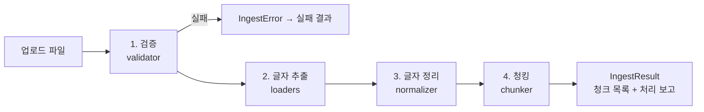

# ingest 기능 명세 (spec)

> 담당: 김혜리 · 위치: `hyundap/ingest/`
> 상태: **구현 완료(리뷰중)** — 이 문서는 구현 계획과 함께 갱신합니다.
> 기준 문서: 공유 드라이브 `문서검색_통합_기능명세서.xlsm.xlsx`


## 1. 한눈에 보기

**ingest는 "업로드된 문서 파일 1개를, 검색할 수 있는 작은 조각(청크) 여러 개로 바꿔 주는 폴더"입니다.**

| 항목 | 내용 |
|---|---|
| 하는 일 | 파일 검증 → 글자 추출 → 글자 정리 → 청크로 자르기 |
| 받는 것 | 파일 경로, 업로드 정보(문서 번호·회사·문서 유형·파일명 등) |
| 돌려주는 것 | `IngestResult` — 성공이면 청크 목록, 실패면 오류 코드와 문구 |
| 지원 형식 | PDF · DOCX · PPTX (100MiB 이하) |
| 하지 않는 일 | 파일 저장·DB 기록(db), 임베딩·벡터 저장(embedding), 화면(ui), 권한 판단(auth) |

예) 현대엘리베이터 PDF 1개(40쪽)를 넣으면 → 쪽마다 글자를 꺼내 정리한 뒤 → 1,000자 안팎 청크 여러 개로 잘라서 돌려줍니다.
각 청크에는 "어느 회사의 어느 파일 몇 쪽(또는 몇 번 슬라이드)"인지가 붙어 있어, 검색 결과의 **출처 표시**에 그대로 쓰입니다.

## 2. 처리 흐름



1. **검증** — 형식 → 용량 → 암호화 → 손상 → 해시 계산 → 중복 순서로 검사하고, 하나라도 걸리면 그 자리에서 멈춥니다.
2. **글자 추출** — 확장자에 맞는 로더가 문서를 `CommonDocument`(문서 헤더 + 섹션 목록)로 바꿉니다.
3. **글자 정리** — 한글 결합, 보이지 않는 글자 제거, 공백·빈 줄 정리. 기호와 숫자는 바꾸지 않습니다.
4. **청킹** — 섹션(쪽·슬라이드·제목 구간)마다 따로 잘라서 **청크가 섹션 경계를 넘지 않게** 합니다.

이 전체를 한 번에 실행하는 함수가 `ingest_document` (`pipeline.py`) 입니다.

## 3. 다른 폴더(기능)와의 관계

| 상대 | 방향 | 내용 |
|---|---|---|
| db (전재경) | db → ingest | 업로드 처리 흐름에서 `ingest_document`를 호출 |
| db (전재경) | ingest → db | 중복 검사 때 "같은 회사에 같은 해시 문서가 있는지" 조회 (`documents_repo.py`) |
| db (전재경) | ingest → db | 처리 결과·실패 원인은 `IngestResult`로 돌려주고, 기록은 db가 함 |
| embedding (박영준) | ingest → embedding | 청크 목록을 `embed_and_store`의 입력으로 전달 |
| common (이성민) | 공용 | `CommonDocument`, `Chunk` 형식을 `common/schemas.py`에서 가져다 씀 |
| ui (박경환) | — | ingest를 직접 부르지 않음 (업로드 화면 → db → ingest 순) |

> 폴더 규칙: 다른 폴더의 파일은 고치지 않고, 필요하면 그 폴더의 함수를 호출합니다 (`작업폴더_구조.md`).

## 4. 파일·함수 구성

| 파일 | 함수 · 클래스 | 하는 일 |
|---|---|---|
| `models.py` | `IngestError`, `IngestResult` | 오류(코드+문구), 처리 결과 |
| `validator.py` | `validate_upload` | 검사 6단계를 순서대로 실행 |
| | `check_file_format` / `check_file_size` | 확장자·시그니처 / 1바이트~100MiB |
| | `check_not_encrypted` / `check_not_corrupted` | 암호 문서 / 깨진 문서 |
| | `compute_file_hash` / `check_duplicate` | SHA-256 계산 / 같은 회사 중복 |
| `ocr.py` | `is_available`, `ocr_image`, `warm_up`, `start_warm_up` | PaddleOCR 엔진(지연 로딩·한 번만 생성), 이미지 OCR, 서버 시작 때 예열 |
| `loaders/__init__.py` | `load_document` | 확장자별 로더 선택 |
| `loaders/pdf_loader.py` | `load_pdf` | 쪽마다 섹션 1개 |
| `loaders/docx_loader.py` | `load_docx` | 제목 스타일마다 섹션 1개 |
| `loaders/pptx_loader.py` | `load_pptx` | 슬라이드마다 섹션 1개 |
| `loaders/base.py` | `table_to_text`, `build_location_label` | 표→마크다운, 출처 위치 문구 |
| `loaders/figures.py` | `FigureReader`, `is_figure_size`, `drop_duplicate_lines`, `picture_to_array` | 그림 OCR 공통(크기 기준·중복 제거·상한·저해상도 확대) |
| `loaders/charts.py` | `chart_to_text`, `ChartReader` | Office 차트 XML → 제목 머리글 붙은 표 (DOCX·PPTX) |
| `normalizer.py` | `normalize_text`, `normalize_document` | 글자 정리 |
| `chunker.py` | `to_langchain_documents`, `build_chunk`, `chunk_document` | 섹션별 청킹, 위치 정보 유지 |
| `pipeline.py` | `ingest_document`, `build_ingest_report` | 전체 일괄 실행, 처리 보고 |

함수 ID(FUN-200~219)와 기능 ID(F60~F72)는 통합 명세서와 같습니다.

## 5. 기능별 상세

### F60~F63 업로드 파일 검증 (`validator.py`)

| 순서 | 검사 | 기준 | 걸리면 |
|---|---|---|---|
| ① | 형식 | 확장자 `.pdf/.docx/.pptx` + 파일 앞부분(시그니처)이 실제 형식과 일치 | `UNSUPPORTED_FORMAT` |
| ② | 용량 | 1바이트 이상 100MiB(104,857,600바이트) 이하 | `FILE_TOO_LARGE`, 0바이트는 `CORRUPTED_FILE` |
| ③ | 암호화 | PDF는 `is_encrypted`. DOCX·PPTX가 OLE2로 시작하면 안의 스트림 이름으로 구분: `EncryptedPackage`·`EncryptionInfo`는 암호 문서, `WordDocument`·`PowerPoint Document`는 구형 .doc/.ppt, 둘 다 아니면 그 밖의 OLE2 | `ENCRYPTED_FILE` / `LEGACY_FORMAT` / `UNSUPPORTED_FORMAT` |
| ④ | 손상 | PDF는 1쪽 이상 열림, DOCX·PPTX는 압축 정상 + 필수 파일 존재 | `CORRUPTED_FILE` |
| ⑤ | 해시 | 파일 전체 SHA-256 (1MiB씩 읽음); 호출자가 검증한 해시를 제공하면 재사용 | — |
| ⑥ | 중복 | 같은 회사에 같은 해시 문서가 있으면 중복 (파일명이 달라도) | `DUPLICATE_FILE` |

- 비밀번호를 받아 푸는 기능은 없습니다.
- OLE2 구분은 파일을 해석하지 않고 스트림 이름(UTF-16LE) 바이트를 찾는 방식이라 의존성이 없습니다. 실제 암호 DOCX/PPTX와 LibreOffice로 만든 구형 .doc/.ppt로 확인했으며, 다른 Office 버전이 만든 파일은 샘플로 더 확인해야 합니다.
- 구형 `.doc/.ppt`, 매크로 `.docm/.pptm`, HWP, XLSX, 이미지는 이번 범위 밖이라 거부합니다.
- 확장자만 바꾼 다른 Office 파일(xlsx·pptx를 `.docx`로, docx를 `.pptx`로 등)과 매크로(`vbaProject.bin`)가 든 파일은 손상이 아니라 `UNSUPPORTED_FORMAT`입니다.
- 압축 데이터가 깨져 읽을 수 없는 DOCX·PPTX, 읽는 중 pypdf가 예외를 내는 PDF는 예외가 아니라 `CORRUPTED_FILE` 결과로 돌아옵니다. (패키지 미설치 같은 개발자 실수는 그대로 올라옵니다.)

### F64 로더 선택 (`loaders/__init__.py`)

`.pdf → load_pdf`, `.docx → load_docx`, `.pptx → load_pptx`. 모든 로더는 같은 `CommonDocument`를 돌려주므로, **새 형식은 로더 파일 1개 + 선택표 한 줄**만 추가하면 됩니다.

### F65~F67 형식별 글자 추출

| 형식 | 섹션 나누는 기준 | 출처 위치 문구 | 제외·한계 |
|---|---|---|---|
| PDF | 쪽 1개 = 섹션 1개 | `p.3` | 글자 레이어가 없는 쪽(스캔 이미지)은 PaddleOCR로 쪽 전체를 읽음(200dpi, 문서당 `OCR_MAX_PAGES`(기본 50)쪽까지, 경고에 `OCR로 읽음`). 글자 레이어가 있는 쪽 안의 그림(그래프·표 이미지)은 그림 영역만 300dpi로 잘라 OCR해서 본문 뒤에 붙임(문서당 `OCR_MAX_FIGURES`(기본 100)개까지, 신뢰도 0.5 미만 줄은 버림, 본문과 거의 같은 줄은 뺌, 문서 경고에 쪽·그림 수를 한 줄로 남김. 로고 크기의 작은 그림과 쪽 면적 85% 이상인 그림은 제외). 미설치이거나 OCR로도 못 읽어 전체가 비면 `EMPTY_DOCUMENT`. 스캐너가 넣은 글자 레이어는 품질과 관계없이 그대로 씀. 표는 일반 글자로 나옴. 2단 편집은 줄이 섞일 수 있음 |
| DOCX | 제목(Heading) 스타일마다 새 섹션. 제목이 없으면 문서 전체가 1개 | `섹션 2 (제목)` | 페이지 번호가 파일에 저장되지 않아 정확한 쪽수는 알 수 없음. 머리글·바닥글·각주·텍스트상자 제외. 그림은 PaddleOCR가 있으면 OCR해 그림이 있는 문단 뒤(표 칸 안 그림은 표 뒤)에 넣음(PDF와 같은 크기·신뢰도·중복·개수 기준, 저해상도는 최대 3배 확대). Office 차트 개체는 OCR이 아니라 차트 XML에서 제목·항목·계열·값을 읽어 `[차트] 제목 (종류)` 머리글이 붙은 표로 차트 자리에 넣음(항목 60·계열 12·문서당 200개 상한, 넘으면 앞부분만 넣고 표 끝에 안내). EMF 그림과 새 차트 종류(chartex)는 못 읽어 경고에 개수만 남김 |
| PPTX | 슬라이드 1장 = 섹션 1개. 도형을 위→아래, 왼→오른쪽 순서로 읽고 그룹 도형 안까지 들어감. 위쪽 끝이 0.1인치 이내로 어긋난 도형은 같은 줄로 봄(줄 기준은 그 줄 첫 도형) | `슬라이드 5` | 발표자 노트 제외. 그림은 PaddleOCR가 있으면 읽기 순서대로 그림 자리에서 OCR(그림만 있는 슬라이드도 섹션이 됨, 슬라이드 전체를 덮는 배경 그림은 제외, 요약 경고에 슬라이드 수·그림 수). 차트 도형은 DOCX와 같이 차트 XML에서 읽어 읽기 순서대로 그 자리에 넣음 |

글자가 없는 쪽·슬라이드는 섹션을 만들지 않고 `warnings`에 남깁니다. PPTX는 발표자 노트에만 글자가 있는 슬라이드를 일반 빈 슬라이드와 구분해 적습니다. DOCX는 콘텐츠 컨트롤(`w:sdt`) 안의 본문까지 읽고, 표 칸 안의 표(중첩 표)는 안쪽 글자를 바깥 칸에 이어 붙이며 `warnings`에 남깁니다. 글자를 읽지 않는 그림·도형·차트·텍스트 상자(DOCX), 이미지·차트·미디어·OLE 개체(PPTX, 슬라이드 번호 최대 10개 표기)는 개수만 문서당 경고 1개로 남깁니다. OCR이나 차트 읽기로 글자를 읽은 그림·차트는 이 개수에서 뺍니다.

### F68 표 처리 (`loaders/base.py`)

DOCX·PPTX의 표를 마크다운 표로 바꿉니다. 표가 길면 행 묶음으로 나누고, **조각마다 맨 위에 머리글 행을 복제**해서 어느 조각을 봐도 열 이름을 알 수 있게 합니다. 병합 셀은 빈 칸으로 나올 수 있어 경고 대상입니다. (P2) 모든 칸이 빈 표는 조각을 만들지 않으며, 한 행이 혼자서 `max_chars`를 넘으면 가장 긴 칸을 나눠 여러 행으로 만들되 다른 칸은 반복하고 모든 조각에 머리글을 붙입니다.

### F69 글자 정리 (`normalizer.py`)

섹션마다 
① 한글 자모를 완성형으로 결합(NFC) 
② 제어·보이지 않는 글자 제거 
③ 전각 공백·탭을 공백 1칸으로 
④ 연속 공백을 1칸으로 
⑤ 줄 끝 공백 제거 
⑥ 3줄 이상 빈 줄을 1줄로. 
- 정리 후, 비어 버린 섹션은 뺍니다. 
- `①`, `%`, 숫자 같은 기호는 바꾸지 않습니다.

### F70~F71 청킹과 위치 정보 (`chunker.py`)

- 섹션 1개를 LangChain `Document` 1개로 바꾼 뒤 `RecursiveCharacterTextSplitter`로 자릅니다. Document마다 따로 자르므로 **쪽·슬라이드 경계를 넘는 청크가 없습니다.** 자르는 순서는 문단(빈 줄) → 줄 → 공백 → 글자.
- 기본값은 `chunk_size=1000`, `chunk_overlap=150`입니다 (임베딩 쪽 "청크 1000자 기준"과 맞춤). 값은 `hyundap.common.config.get_settings()`의 `chunk_size`·`chunk_overlap`에서 읽으며, `.env`의 `CHUNK_SIZE`·`CHUNK_OVERLAP`으로 바꿀 수 있습니다. 검색 질문 세트로 성능을 재서 확정합니다.
- 청크마다 문서 정보(`document_id, version_id, company_id, company_name, doc_type, file_name`)와 위치(`section_no, location_label`), 문서 안 순번(`chunk_index`), `chunk_id`를 붙입니다.

### F72 일괄 실행 (`pipeline.py`)

`validate_upload → load_document → normalize_document → 빈 문서 확인 → chunk_document → build_ingest_report` 순서로 실행합니다.
- `IngestError`가 나면 `status="failed"` 결과로 바꿔 돌려줍니다.
- 예상하지 못한 오류(버그)는 숨기지 않고 그대로 올립니다.
- 텍스트가 하나도 없으면 `EMPTY_DOCUMENT`.
## 6. 데이터 형식

```text
upload_info (dict)   document_id, version_id, company_id, company_name, doc_type, file_name

CommonDocument       header(dict: upload_info와 같은 키)
                     sections(list[Section])   ← 쪽/슬라이드/제목 구간 1개씩
                     warnings(list[str])       ← 글자 없는 쪽, 병합 셀 등

Chunk                chunk_id, document_id, version_id, company_id, company_name,
                     doc_type, file_name, section_no, location_label, chunk_index, text

IngestResult         status("success"|"failed"), chunks(list[Chunk]), report(dict),
                     error_code(str|None), error_message(str|None)
```

`CommonDocument`와 `Chunk`는 `common/schemas.py`(이성민 관리)에 정의됩니다. `IngestError`, `IngestResult`는 `ingest/models.py`에 둡니다.

## 7. 오류 코드 (`IngestError`)

| 코드 | 뜻 | 발생 위치 | 사용자 안내 문구 |
|---|---|---|---|
| `UNSUPPORTED_FORMAT` | 지원하지 않는 형식 | 형식 검사, 로더 선택 | PDF, DOCX, PPTX 파일만 업로드할 수 있습니다. |
| `FILE_TOO_LARGE` | 100MiB 초과 | 용량 검사 | 파일은 100MiB 이하로 선택해 주세요. |
| `ENCRYPTED_FILE` | 암호가 걸린 문서 | 암호화 검사 | 암호가 걸린 파일은 등록할 수 없습니다. 암호를 해제한 뒤 다시 올려 주세요. |
| `CORRUPTED_FILE` | 깨진 파일 또는 0바이트 | 용량·손상 검사, 로더 | 파일이 손상되었거나 비어 있어 열 수 없습니다. 파일을 확인한 뒤 다시 올려 주세요. |
| `DUPLICATE_FILE` | 같은 회사에 같은 내용이 이미 있음 | 중복 검사 | 같은 회사에 동일한 내용의 파일이 이미 등록되어 있습니다. |
| `EMPTY_DOCUMENT` | 추출된 글자가 없음 (OCR로도 읽지 못한 이미지 문서 등) | 로더 이후, 청킹 | 문서에서 글자를 읽을 수 없습니다. 글자가 없는 문서이거나 스캔한 이미지 문서일 수 있습니다. |
| `LEGACY_FORMAT` | 구형 .doc/.ppt를 .docx/.pptx로 이름만 바꾼 파일 | 암호화 검사 | 구형 형식은 지원하지 않습니다. .docx 또는 .pptx로 저장한 뒤 다시 올려 주세요. |
| `INVALID_DOC_TYPE` | 지원하지 않는 문서 유형 | 수집 진입 | 문서 유형을 확인해 주세요. |
| `FILE_UNAVAILABLE` | 파일을 찾을 수 없거나 읽을 권한이 없음 | 수집 처리 | 파일을 다시 업로드해 주세요. |

- 안내 문구는 `IngestError`의 기본 문구다. DB 업로드 결과는 원문을 전달하지 않고 UI가 코드별 안내를 표시한다.
- DB 후보 생성 전에는 유형·파일 접근 오류도 작업 원장 없이 반환한다.
- 수집 보고서의 `short_chunk_count`는 앞뒤 공백을 제외하고 20자 미만인 청크의 수다. 20자는 임시 진단 기준이며 검색 품질 합격 기준이 아니다.
- 문구는 임시안이며, UI 담당(박경환)과 맞춘 뒤 확정합니다.

## 8. 설정값

| 항목 | 기본값 | 위치 |
|---|---|---|
| 최대 파일 크기 | 104,857,600바이트 (100MiB) | `check_file_size(max_bytes)` |
| 해시 읽기 단위 | 1MiB | `compute_file_hash` |
| 청크 크기 / 겹침 | 1000자 / 150자 | `.env`의 `CHUNK_SIZE`·`CHUNK_OVERLAP` (`get_settings()`) |
| 표 한 조각 최대 글자 | 800자 | `table_to_text(max_chars)` |
| OCR 쪽 수 상한 | 50쪽 | `.env`의 `OCR_MAX_PAGES` (0이면 스캔 쪽 OCR 끔) |
| OCR 그림 수 상한 | 100개 | `.env`의 `OCR_MAX_FIGURES` (0이면 그림 OCR 끔) |
| OCR 스레드 수 | 코어 3개 이상이면 코어 수 − 1, 2개 이하면 코어 수 | `.env`의 `OCR_THREADS` |
| OCR 엔진 예열 | 켜짐 | `.env`의 `OCR_WARMUP` (`0`·`false`면 끔) |
| 그림 크기·면적 기준 | 60×40pt 이상, 쪽 면적의 1% 이상 85% 미만 | `loaders/figures.py` 상수 |
| 그림 OCR 신뢰도·중복 | 0.5 미만 줄 버림, 3글자 조각 80% 이상 겹치면 같은 줄 | `loaders/figures.py` 상수 |
| 차트 읽기 상한 | 항목 60개 · 계열 12개 · 문서당 차트 200개 | `loaders/charts.py` 상수 |

## 9. 구현 계획
※ 아래 7단계는 모두 구현되었습니다.

| 순서 | 만들 것 | 완료 기준 |
|---|---|---|
| 1 | `models.py` — `IngestError`, `IngestResult` | 오류 코드로 오류를 만들고 `code`/`message`를 꺼낼 수 있다 |
| 2 | `validator.py` — 형식·용량 → 암호화·손상 → 해시·중복 | 정상 파일은 통과하고, 잘못된 파일마다 정해진 오류 코드가 나온다 |
| 3 | `loaders/base.py` — `build_location_label`, `table_to_text` | `p.3`, `슬라이드 5`, `섹션 2 (제목)` 문구, 표 조각마다 머리글 복제 |
| 4 | `pdf_loader.py` → `docx_loader.py` → `pptx_loader.py`, `loaders/__init__.py` | 샘플 파일 → `CommonDocument`, 섹션 수·위치 문구가 맞다 |
| 5 | `normalizer.py` | 정규화 전후 비교, 기호·숫자는 그대로 |
| 6 | `chunker.py` | 청크가 섹션 경계를 넘지 않고, 위치 정보가 청크마다 붙는다 |
| 7 | `pipeline.py` | `ingest_document` 한 번으로 성공/실패 결과가 나온다 |

**다른 담당자 일에 의존하는 부분** (막히면 먼저 협의)
- `common/schemas.py`의 `CommonDocument`·`Chunk` 필드 확정 (이성민) — 현재 파일은 비어 있음
- 중복 검사용 해시 조회 함수 이름·반환 형식 (전재경) — 확정 전에는 가짜 함수로 대체해 테스트

## 10. 테스트 계획 (`tests/test_ingest.py`)

공유 드라이브 `목업 데이터`(500개: PDF 200 · DOCX 165 · PPTX 135, 3개 회사)의 파일을 샘플로 씁니다.

| 확인할 것 | 샘플 |
|---|---|
| 정상 처리 | 형식별 1개 이상 (공개 PDF, 가상 매뉴얼 DOCX, 가상 교육자료 PPTX) |
| 표가 있는 문서 | 표가 들어 있는 DOCX/PPTX → 조각마다 머리글 복제 |
| 글자 없는 PDF | 일부 카탈로그는 글자가 윤곽선·이미지라 `EMPTY_DOCUMENT` 후보 (데이터 안내문 근거) |
| 오류 사례 | 직접 만든 빈 파일(0바이트), 확장자만 바꾼 파일, 암호 PDF, 같은 파일 두 번 업로드 |
| 경계 | 쪽 사이·슬라이드 사이에서 청크가 이어지지 않는지 |

- 주의: 공개 자료는 개인 실습용 수집본이라 **공개 저장소에 올리지 않습니다** (테스트용 샘플은 별도 관리).
- DOCX 페이지 번호는 추측하지 않는다는 데이터 안내문 규칙과 같은 방침입니다.
- OCR·그림·차트 단위 테스트(`OcrTests`, `FigureOcrTests`, `DocxFigureOcrTests`, `PptxFigureOcrTests`, `ChartTextTests`, `OcrEngineTests` 등)는 PaddleOCR 없이 도는 가짜 엔진으로 확인합니다. 실제 모델 정확도·속도는 스캔 PDF 3개와 보고서 PDF 1개로 직접 실측했습니다(13절).

## 11. 미정·협의 사항

| 항목 | 내용 | 협의 대상 |
|---|---|---|
| 호출 창구 | 업로드 화면이 `validate_upload`를 직접 부를지, `ingest_document`만 부를지 | 박경환 · 전재경 |
| 중복 조회 함수 | 이름·반환 형식 | 전재경 |
| 결과 전달 | 청크는 `embed_and_store`로, 실패 원인은 db 기록 함수로 전달 (함수명) | 박영준 · 전재경 |
| 공통 형식 | `CommonDocument`·`Chunk` 필드, dataclass/Pydantic 중 무엇을 쓸지 | 이성민 |
| `chunk_id` 규칙 | `f"{version_id}:{chunk_index:05d}"` (박영준 제안) | 박영준 |
| DOCX 출처 문구 | `섹션 N (제목)` 문구 | 팀 |
| 암호 DOCX/PPTX 판별 | 스트림 이름으로 구분하도록 구현(#145). 실제 암호 파일 샘플로 확인 | 로컬 샘플로 재확인 |
| HWP·XLSX | 명세는 범위 밖(거부)인데 WBS 이슈 #65·#66에는 로더가 있음 | 팀장 |
| 일정 | README·작업폴더_구조.md·WBS의 날짜가 서로 다름 | 팀장 |
| OCR·차트 새 함수 ID | ingest ID 구간(F60~F72·FUN-200~219)이 다 차서 `ocr.py`·`figures.py`·`charts.py`의 새 함수에 번호를 매기지 못함 (통합 명세서 미정 목록 122) | 이성민 |
| 업로드 처리 시간 | 스캔 쪽당 2~5초, 상한 50쪽이면 최악 2~4분. 업로드가 한 요청 안에서 끝날 때까지 이어지고 `WORKFLOW_LOCK` 안이라 다른 업로드가 대기함. 화면 안내·비동기 처리 필요 여부 | 박경환 · 전재경 |
| 텍스트 상자·도형 글자 | DOCX 텍스트 상자·도형 속 글자는 읽지 않음 | 팀 |

## 12. 관련 문서

- 통합 기능명세서: [`docs/spec.md`](../../../docs/spec.md) 3.2절 (ingest), 4~7절
- 기능 도식도: [`docs/diagrams/1_문서_업로드_색인.png`](../../../docs/diagrams/1_문서_업로드_색인.png)
- 폴더 구조·규칙: 공유 드라이브 `작업폴더_구조.md`
- 이 폴더 소개: [`../README.md`](../README.md)

## 13. OCR 도구 선택 기록

### 결정

**로컬 PaddleOCR(PP-OCRv5 모바일 검출 + 한국어 인식)** 로 스캔 쪽과 그림 속 글자를 읽는다.

### 선택 요인(의도한 이유)

- 처음 정한 기준: **무료 · 속도 · 한글 정확도**.
- 수업의 "모델 선택 4기준"(정확도 vs 비용 / 속도 / 컨텍스트 크기 / 데이터 보안)과 맞추면 이렇다.
  - **데이터 보안:** 내부(사내) 데이터라면 로컬 모델을 쓴다는 수업 기준에 따라, 문서 내용이 외부 서버로 나가지 않는 **로컬 실행**을 택했다.
  - **비용:** 앞서 정한 **무료 조건**에 맞게 호출당 비용이 없는 오픈소스 도구를 택했다.
  - **속도:** GPU 없는 CPU 서버에서 쓸 만한 속도(쪽당 약 2~5초)가 나오는지 실측했다.
  - **정확도:** 한글 위주 문서(표·그래프 포함)로 실측했다.
  - 컨텍스트 크기는 OCR 도구 선택과 관계없다.
- 외부 전송 허용 여부는 아직 정해지지 않았지만, 허용되지 않아도 동작하는 쪽을 기본으로 삼았다.

### 후보와 결과

측정 조건: 컨테이너 1대(CPU 4코어, GPU 없음), 같은 문서·같은 해상도(200dpi). 스캔 3개·보고서 1개로 직접 측정했고, 정답은 글자 레이어 또는 사람이 이미지를 보고 옮긴 글이다(표본이 작아 소수점 차이는 의미가 없다).

| 도구 | 비용·보안 | 디지털 보고서 재현율 | 스캔 일치도(법전/요리책/영문) | 쪽당 시간(CPU) | 판단 |
|---|---|---|---|---|---|
| **PaddleOCR 모바일 검출** | 무료 · 로컬 | 94.9% | 0.995 / 0.941 / 0.961 | 1.2~5.5초 | **채택** |
| PaddleOCR 서버 검출 | 무료 · 로컬 | 95.0% | 0.994 / 0.948 / 0.961 | 4.9~9.3초 | 정확도 차이가 노이즈 수준인데 2~4배 느려 제외 |
| RapidOCR(PP-OCRv5, ONNX) | 무료 · 로컬 | 89.5% | 0.983 / 0.895 / 0.961 | 1.4~4.4초 | 같은 모델 계열인데 디자인 문서(요리책)에서 낮음. 설치가 무거우면 대안 |
| Tesseract(kor+eng) | 무료 · 로컬 | 83.0% | 0.912 / 0.917 / 0.960 | 1.4~6.4초 | 한글 정확도가 가장 낮음 |
| EasyOCR | 무료 · 로컬 | 미측정 | 미측정 | 미측정 | 검색 자료에서 영문 영수증 8개 중 4위, 일부 오독 보고(출처가 블로그성이라 참고만) |
| Surya OCR 2 | 코드 Apache 2.0, 가중치는 매출 규모 등 조건부(버전마다 다름) | 미측정 | 미측정 | 미측정 | 가중치 라이선스 검토가 먼저 필요 |
| Naver Clova OCR | 외부 전송, 무료 한도 작음 | 미측정 | 미측정 | 미측정 | 공식 문서상 General OCR 무료는 월 100회(표 100회)로 확인(사용자가 알려준 월 1,000건은 확인되지 않음, 최신 요금은 콘솔에서 확인 필요). 문서 내용이 외부로 나가고 15쪽 문서 7개쯤이면 한도가 끝나 제외 |

- 외부 도구 3개(EasyOCR·Surya·Clova)의 내용은 웹 검색 결과이며 직접 측정하지 않았다. 한국어를 같은 조건으로 비교한 독립 벤치마크는 찾지 못했다.
- 모바일 검출은 쪽 전체를 읽을 때 작은 글자(그래프 범례·눈금)에 약했지만, **그림 영역만 잘라 300dpi로 읽으면** 서버 검출 수준이 됐다(그래프 2쪽 정답 토큰 모바일 30/32·45/46, 서버 쪽 전체 29/32·45/46).

### 알려진 함정

- 검출 모델 이름만 지정하면 한국어 인식 모델 선택이 풀려 한글이 공백으로 나온다. 검출·인식 모델 이름을 함께 지정한다.
- PaddlePaddle 3.3.x는 CPU에서 oneDNN 오류가 나고, oneDNN을 끄면 쪽당 약 21초로 느려져 3.2.0으로 고정한다.
- 의존성: `pypdfium2==5.14.0`은 `requirements.txt`, `paddlepaddle==3.2.0`·`paddleocr==3.7.0`은 선택 설치 `requirements-ocr.txt`다. PaddleOCR 설치가 numpy(2.5.x → 2.3.x)와 PyYAML(6.0.3 → 6.0.2)을 내려서 PR 리뷰에서 분리했다. 설치하지 않아도 업로드는 OCR 없이 동작한다.

### 다시 검토할 조건

- 외부 전송이 허용되고 도장·손글씨 정확도가 중요해지면 외부 OCR API(Clova 등)를 로컬 OCR과 병행하는 방안.
- GPU 서버가 생기면 서버 검출·더 큰 모델.
- 스캔 PDF가 많아 업로드 대기가 문제가 되면 업로드를 비동기로 바꾸는 방안(11절 협의).
