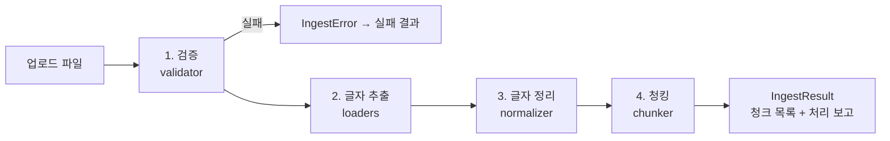

# ingest 기능 명세 (spec)

> 담당: 김혜리 · 위치: `hyundap/ingest/`
> 상태: **설계 단계 (구현 전)** — 이 문서는 구현 계획과 함께 갱신합니다.
> 기준 문서: 공유 드라이브 `문서검색_통합_기능명세서.xlsm.xlsx`


## 1. 한눈에 보기

**ingest는 "업로드된 문서 파일 1개를, 검색할 수 있는 작은 조각(청크) 여러 개로 바꿔 주는 폴더"입니다.**

| 항목 | 내용 |
|---|---|
| 하는 일 | 파일 검증 → 글자 추출 → 글자 정리 → 청크로 자르기 |
| 받는 것 | 파일 경로, 업로드 정보(문서 번호·회사·문서 유형·파일명 등) |
| 돌려주는 것 | `IngestResult` — 성공이면 청크 목록, 실패면 오류 코드와 문구 |
| 지원 형식 | PDF · DOCX · PPTX (100MiB 이하) |
| 하지 않는 일 | 파일 저장·DB 기록(db), 임베딩·벡터 저장(embedding), 화면(ui), 권한 판단(auth) |

예) 현대엘리베이터 PDF 1개(40쪽)를 넣으면 → 쪽마다 글자를 꺼내 정리한 뒤 → 1,000자 안팎 청크 여러 개로 잘라서 돌려줍니다.
각 청크에는 "어느 회사의 어느 파일 몇 쪽(또는 몇 번 슬라이드)"인지가 붙어 있어, 검색 결과의 **출처 표시**에 그대로 쓰입니다.

## 2. 처리 흐름



1. **검증** — 형식 → 용량 → 암호화 → 손상 → 해시 계산 → 중복 순서로 검사하고, 하나라도 걸리면 그 자리에서 멈춥니다.
2. **글자 추출** — 확장자에 맞는 로더가 문서를 `CommonDocument`(문서 헤더 + 섹션 목록)로 바꿉니다.
3. **글자 정리** — 한글 결합, 보이지 않는 글자 제거, 공백·빈 줄 정리. 기호와 숫자는 바꾸지 않습니다.
4. **청킹** — 섹션(쪽·슬라이드·제목 구간)마다 따로 잘라서 **청크가 섹션 경계를 넘지 않게** 합니다.

이 전체를 한 번에 실행하는 함수가 `ingest_document` (`pipeline.py`) 입니다.

## 3. 다른 폴더(기능)와의 관계

| 상대 | 방향 | 내용 |
|---|---|---|
| db (전재경) | db → ingest | 업로드 처리 흐름에서 `ingest_document`를 호출 |
| db (전재경) | ingest → db | 중복 검사 때 "같은 회사에 같은 해시 문서가 있는지" 조회 (`documents_repo.py`) |
| db (전재경) | ingest → db | 처리 결과·실패 원인은 `IngestResult`로 돌려주고, 기록은 db가 함 |
| embedding (박영준) | ingest → embedding | 청크 목록을 `embed_and_store`의 입력으로 전달 |
| common (이성민) | 공용 | `CommonDocument`, `Chunk` 형식을 `common/schemas.py`에서 가져다 씀 |
| ui (박경환) | — | ingest를 직접 부르지 않음 (업로드 화면 → db → ingest 순) |

> 폴더 규칙: 다른 폴더의 파일은 고치지 않고, 필요하면 그 폴더의 함수를 호출합니다 (`작업폴더_구조.md`).

## 4. 파일·함수 구성

| 파일 | 함수 · 클래스 | 하는 일 |
|---|---|---|
| `models.py` | `IngestError`, `IngestResult` | 오류(코드+문구), 처리 결과 |
| `validator.py` | `validate_upload` | 검사 6단계를 순서대로 실행 |
| | `check_file_format` / `check_file_size` | 확장자·시그니처 / 1바이트~100MiB |
| | `check_not_encrypted` / `check_not_corrupted` | 암호 문서 / 깨진 문서 |
| | `compute_file_hash` / `check_duplicate` | SHA-256 계산 / 같은 회사 중복 |
| `loaders/__init__.py` | `load_document` | 확장자별 로더 선택 |
| `loaders/pdf_loader.py` | `load_pdf` | 쪽마다 섹션 1개 |
| `loaders/docx_loader.py` | `load_docx` | 제목 스타일마다 섹션 1개 |
| `loaders/pptx_loader.py` | `load_pptx` | 슬라이드마다 섹션 1개 |
| `loaders/base.py` | `table_to_text`, `build_location_label` | 표→마크다운, 출처 위치 문구 |
| `normalizer.py` | `normalize_text`, `normalize_document` | 글자 정리 |
| `chunker.py` | `to_langchain_documents`, `build_chunk`, `chunk_document` | 섹션별 청킹, 위치 정보 유지 |
| `pipeline.py` | `ingest_document`, `build_ingest_report` | 전체 일괄 실행, 처리 보고 |

함수 ID(FUN-200~219)와 기능 ID(F60~F72)는 통합 명세서와 같습니다.

## 5. 기능별 상세

### F60~F63 업로드 파일 검증 (`validator.py`)

| 순서 | 검사 | 기준 | 걸리면 |
|---|---|---|---|
| ① | 형식 | 확장자 `.pdf/.docx/.pptx` + 파일 앞부분(시그니처)이 실제 형식과 일치 | `UNSUPPORTED_FORMAT` |
| ② | 용량 | 1바이트 이상 100MiB(104,857,600바이트) 이하 | `FILE_TOO_LARGE`, 0바이트는 `CORRUPTED_FILE` |
| ③ | 암호화 | PDF는 `is_encrypted`, DOCX·PPTX는 OLE2 시작값 | `ENCRYPTED_FILE` |
| ④ | 손상 | PDF는 1쪽 이상 열림, DOCX·PPTX는 압축 정상 + 필수 파일 존재 | `CORRUPTED_FILE` |
| ⑤ | 해시 | 파일 전체 SHA-256 (1MiB씩 읽음) | — |
| ⑥ | 중복 | 같은 회사에 같은 해시 문서가 있으면 중복 (파일명이 달라도) | `DUPLICATE_FILE` |

- 비밀번호를 받아 푸는 기능은 없습니다.
- 구형 `.doc/.ppt`, 매크로 `.docm/.pptm`, HWP, XLSX, 이미지는 이번 범위 밖이라 거부합니다.

### F64 로더 선택 (`loaders/__init__.py`)

`.pdf → load_pdf`, `.docx → load_docx`, `.pptx → load_pptx`. 모든 로더는 같은 `CommonDocument`를 돌려주므로, **새 형식은 로더 파일 1개 + 선택표 한 줄**만 추가하면 됩니다.

### F65~F67 형식별 글자 추출

| 형식 | 섹션 나누는 기준 | 출처 위치 문구 | 제외·한계 |
|---|---|---|---|
| PDF | 쪽 1개 = 섹션 1개 | `p.3` | 스캔본(이미지)은 글자가 없어 OCR 없이는 못 읽음 → 전체가 비면 `EMPTY_DOCUMENT`. 표는 일반 글자로 나옴. 2단 편집은 줄이 섞일 수 있음 |
| DOCX | 제목(Heading) 스타일마다 새 섹션. 제목이 없으면 문서 전체가 1개 | `섹션 2 (제목)` | 페이지 번호가 파일에 저장되지 않아 정확한 쪽수는 알 수 없음. 머리글·바닥글·각주·텍스트상자·이미지 제외 |
| PPTX | 슬라이드 1장 = 섹션 1개. 도형을 위→아래, 왼→오른쪽 순서로 읽고 그룹 도형 안까지 들어감 | `슬라이드 5` | 발표자 노트·이미지·차트 속 글자 제외 |

글자가 없는 쪽·슬라이드는 섹션을 만들지 않고 `warnings`에 남깁니다.

### F68 표 처리 (`loaders/base.py`)

DOCX·PPTX의 표를 마크다운 표로 바꿉니다. 표가 길면 행 묶음으로 나누고, **조각마다 맨 위에 머리글 행을 복제**해서 어느 조각을 봐도 열 이름을 알 수 있게 합니다. 병합 셀은 빈 칸으로 나올 수 있어 경고 대상입니다. (P2)

### F69 글자 정리 (`normalizer.py`)

섹션마다 
① 한글 자모를 완성형으로 결합(NFC) 
② 제어·보이지 않는 글자 제거 
③ 전각 공백·탭을 공백 1칸으로 
④ 연속 공백을 1칸으로 
⑤ 줄 끝 공백 제거 
⑥ 3줄 이상 빈 줄을 1줄로. 
- 정리 후, 비어 버린 섹션은 뺍니다. 
- `①`, `%`, 숫자 같은 기호는 바꾸지 않습니다.

### F70~F71 청킹과 위치 정보 (`chunker.py`)

- 섹션 1개를 LangChain `Document` 1개로 바꾼 뒤 `RecursiveCharacterTextSplitter`로 자릅니다. Document마다 따로 자르므로 **쪽·슬라이드 경계를 넘는 청크가 없습니다.** 자르는 순서는 문단(빈 줄) → 줄 → 공백 → 글자.
- 기본값은 `chunk_size=1000`, `chunk_overlap=150`입니다 (임베딩 쪽 "청크 1000자 기준"과 맞춤). 이 부분은 용우가 기본값으로 넣어놨고(1000), 구현 과정에서 설정으로 바꿀 수 있게 하며 검색 질문 세트로 성능을 재서 확정합니다.
- 청크마다 문서 정보(`document_id, version_id, company_id, company_name, doc_type, file_name`)와 위치(`section_no, location_label`), 문서 안 순번(`chunk_index`), `chunk_id`를 붙입니다.

### F72 일괄 실행 (`pipeline.py`)

`validate_upload → load_document → normalize_document → 빈 문서 확인 → chunk_document → build_ingest_report` 순서로 실행합니다.
- `IngestError`가 나면 `status="failed"` 결과로 바꿔 돌려줍니다.
- 예상하지 못한 오류(버그)는 숨기지 않고 그대로 올립니다.
- 텍스트가 하나도 없으면 `EMPTY_DOCUMENT`.

## 6. 데이터 형식

```text
upload_info (dict)   document_id, version_id, company_id, company_name, doc_type, file_name

CommonDocument       header(dict: upload_info와 같은 키)
                     sections(list[Section])   ← 쪽/슬라이드/제목 구간 1개씩
                     warnings(list[str])       ← 글자 없는 쪽, 병합 셀 등

Chunk                chunk_id, document_id, version_id, company_id, company_name,
                     doc_type, file_name, section_no, location_label, chunk_index, text

IngestResult         status("success"|"failed"), chunks(list[Chunk]), report(dict),
                     error_code(str|None), error_message(str|None)
```

`CommonDocument`와 `Chunk`는 `common/schemas.py`(이성민 관리)에 정의됩니다. `IngestError`, `IngestResult`는 `ingest/models.py`에 둡니다.

## 7. 오류 코드 (`IngestError`)

| 코드 | 뜻 | 발생 위치 |
|---|---|---|
| `UNSUPPORTED_FORMAT` | 지원하지 않는 형식 | 형식 검사, 로더 선택 |
| `FILE_TOO_LARGE` | 100MiB 초과 | 용량 검사 |
| `ENCRYPTED_FILE` | 암호가 걸린 문서 | 암호화 검사 |
| `CORRUPTED_FILE` | 깨진 파일 또는 0바이트 | 용량·손상 검사, 로더 |
| `DUPLICATE_FILE` | 같은 회사에 같은 내용이 이미 있음 | 중복 검사 |
| `EMPTY_DOCUMENT` | 추출된 글자가 없음 (스캔본 등) | 로더 이후, 청킹 |

## 8. 설정값

| 항목 | 기본값 | 위치 |
|---|---|---|
| 최대 파일 크기 | 104,857,600바이트 (100MiB) | `check_file_size(max_bytes)` |
| 해시 읽기 단위 | 1MiB | `compute_file_hash` |
| 청크 크기 / 겹침 | 1000자 / 150자 | `chunk_document(chunk_size, chunk_overlap)` |
| 표 한 조각 최대 글자 | 800자 | `table_to_text(max_chars)` |

## 9. 구현 계획

앞 단계가 끝나야 다음 단계를 테스트할 수 있어서 아래 순서로 진행합니다. (일정은 WBS/이슈 기준으로 확정 — 11번 참고)

| 순서 | 만들 것 | 완료 기준 |
|---|---|---|
| 1 | `models.py` — `IngestError`, `IngestResult` | 오류 코드 6개로 오류를 만들고 `code`/`message`를 꺼낼 수 있다 |
| 2 | `validator.py` — 형식·용량 → 암호화·손상 → 해시·중복 | 정상 파일은 통과하고, 잘못된 파일마다 정해진 오류 코드가 나온다 |
| 3 | `loaders/base.py` — `build_location_label`, `table_to_text` | `p.3`, `슬라이드 5`, `섹션 2 (제목)` 문구, 표 조각마다 머리글 복제 |
| 4 | `pdf_loader.py` → `docx_loader.py` → `pptx_loader.py`, `loaders/__init__.py` | 샘플 파일 → `CommonDocument`, 섹션 수·위치 문구가 맞다 |
| 5 | `normalizer.py` | 정규화 전후 비교, 기호·숫자는 그대로 |
| 6 | `chunker.py` | 청크가 섹션 경계를 넘지 않고, 위치 정보가 청크마다 붙는다 |
| 7 | `pipeline.py` | `ingest_document` 한 번으로 성공/실패 결과가 나온다 |

**다른 담당자 일에 의존하는 부분** (막히면 먼저 협의)
- `common/schemas.py`의 `CommonDocument`·`Chunk` 필드 확정 (이성민) — 현재 파일은 비어 있음
- 중복 검사용 해시 조회 함수 이름·반환 형식 (전재경) — 확정 전에는 가짜 함수로 대체해 테스트

## 10. 테스트 계획 (`tests/test_ingest.py`)

공유 드라이브 `목업 데이터`(500개: PDF 200 · DOCX 165 · PPTX 135, 3개 회사)의 파일을 샘플로 씁니다.

| 확인할 것 | 샘플 |
|---|---|
| 정상 처리 | 형식별 1개 이상 (공개 PDF, 가상 매뉴얼 DOCX, 가상 교육자료 PPTX) |
| 표가 있는 문서 | 표가 들어 있는 DOCX/PPTX → 조각마다 머리글 복제 |
| 글자 없는 PDF | 일부 카탈로그는 글자가 윤곽선·이미지라 `EMPTY_DOCUMENT` 후보 (데이터 안내문 근거) |
| 오류 사례 | 직접 만든 빈 파일(0바이트), 확장자만 바꾼 파일, 암호 PDF, 같은 파일 두 번 업로드 |
| 경계 | 쪽 사이·슬라이드 사이에서 청크가 이어지지 않는지 |

- 주의: 공개 자료는 개인 실습용 수집본이라 **공개 저장소에 올리지 않습니다** (테스트용 샘플은 별도 관리).
- DOCX 페이지 번호는 추측하지 않는다는 데이터 안내문 규칙과 같은 방침입니다.

## 11. 미정·협의 사항

| 항목 | 내용 | 협의 대상 |
|---|---|---|
| 호출 창구 | 업로드 화면이 `validate_upload`를 직접 부를지, `ingest_document`만 부를지 | 박경환 · 전재경 |
| 중복 조회 함수 | 이름·반환 형식 | 전재경 |
| 결과 전달 | 청크는 `embed_and_store`로, 실패 원인은 db 기록 함수로 전달 (함수명) | 박영준 · 전재경 |
| 공통 형식 | `CommonDocument`·`Chunk` 필드, dataclass/Pydantic 중 무엇을 쓸지 | 이성민 |
| `chunk_id` 규칙 | `f"{version_id}:{chunk_index:05d}"` (박영준 제안) | 박영준 |
| DOCX 출처 문구 | `섹션 N (제목)` 문구 | 팀 |
| 암호 DOCX/PPTX 판별 | OLE2 시작값 방식을 실제 암호 파일로 확인 | 구현 때 확인 |
| HWP·XLSX | 명세는 범위 밖(거부)인데 WBS 이슈 #65·#66에는 로더가 있음 | 팀장 |
| 일정 | README·작업폴더_구조.md·WBS의 날짜가 서로 다름 | 팀장 |

## 12. 관련 문서

- 통합 기능명세서: [`docs/spec.md`](../../../docs/spec.md) 3.2절 (ingest), 4~7절
- 기능 도식도: [`docs/diagrams/1_문서_업로드_색인.png`](../../../docs/diagrams/1_문서_업로드_색인.png)
- 폴더 구조·규칙: 공유 드라이브 `작업폴더_구조.md`
- 이 폴더 소개: [`../README.md`](../README.md)
